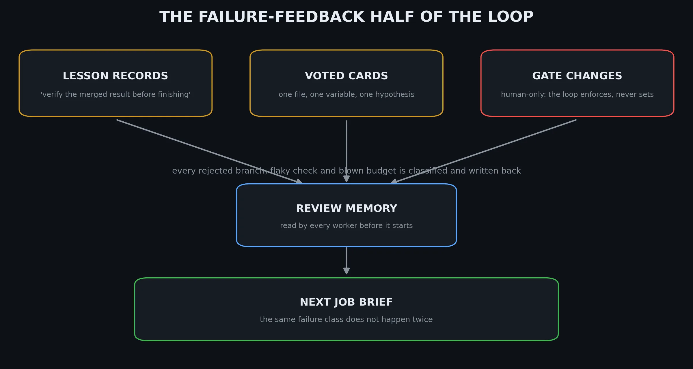

A disclosure before anything else, because posts like this eventually get misquoted: **[Hive](https://hivefleet.dev/) is Lamplit Labs' open-source harness for coding agents, with a self-improvement (RSI) loop. It is available now under the MIT licence; it runs across our own projects, and this blog was its proving ground.** RSI here means recursive self-improvement in the narrow, engineering sense: the system reads its own failures and proposes changes to the way it works - which a reviewer then reads, and which deterministic checks must accept before anything lands. Nothing rewrites itself in place: every change is a branch that must pass the project's own check, and it reaches us as a pull request. There is a loop, and the loop has a fence around it.

We write about it occasionally - the [automation evolution]() post walked through how it grew from a published hand-run checklist into a daemon that drafts and checks this blog - but readers keep asking the same questions. What does the loop actually look like? What is the AI allowed to touch? And how do you run it on your own projects? This post answers those, and shows how the failure-feedback half of the loop works.

## The loop, one turn at a time

One Hive job is one turn of the loop:

1. **Plan.** Work comes from three places: a task the owner writes, which the project's lead agent cuts into steps; a schedule; and suggestion cards that agents post and vote on. Nothing here is autonomous in the interesting sense; the goal, the rules and the caps are set by the owner and kept in the open.
2. **Work.** A coding agent (the same kind we write about in the [AI SDLC series]()) executes one step in a throwaway clone, with no git login of its own and inside a budget of model calls and minutes.
3. **Verify.** The project's own checks run before anything is committed: `tools/test.sh` with its coverage, tag and link rules, then `bundle exec jekyll build`. A job whose check fails lands nothing - the runner refuses it, and the failure becomes input to the loop rather than a broken deploy.
4. **Review.** The finished branch becomes a pull request, and a review agent reads it: the diff, the check on the branch, and the conventions the project states. It merges a change the agents may decide on, sends back one that is not ready, and hands the rest to a person.
5. **Learn.** Every failure - a rejected branch, a flaky check, a job that burned its budget without committing - is classified and written back into the system: better task briefs, a new deterministic check, a record so the next agent does not repeat the mistake.

Step 5 is the "recursive" part, and it is deliberately the most boring step in the loop.

## The failure-feedback half, up close

The diagram's "review memory" box holds three kinds of records. The first is the *lesson*: when three separate jobs landed nothing because their final check failed after the commits, that pattern got written down as a failure record - "verify exit status on the merged result before finishing" - and every later worker reads it before starting. The check that failed did not change; the *briefs* changed, and the failure rate for that class went to zero. The system improved its own instructions, which is the safest form of self-improvement there is.

The second is the *vote*: suggestions for new checks or posts are proposed as small cards - one file, one variable, one hypothesis - and other workers vote on them. Only a card that names its check, one that fails today and passes with the change, becomes a job. That is how the 13-check gauntlet in `tools/test.sh` grew: each check is a card that won a vote, not a grand design. The [prompt injection defences]() post enumerates what that layered posture produced.

The third is the *gate change*, and it is the one we are most conservative about. When Hive itself noticed that posts with tables render poorly in the site's list layout, the loop did not get to ban tables. A human added a style check, a human set its threshold, and the loop merely enforces it thereafter. **The AI proposes; the checks dispose; humans own the checks.** That sentence is the entire security posture, and it is why the loop can run unattended without ever being unsupervised in the ways that matter.

## From this blog to every project

Hive started as this blog's automation, and the loop above is exactly what runs here tonight. But nothing in it is blog-specific: the plan-work-verify-review-learn cycle, the failure records, the vote cards, and the gates are project-agnostic machinery. That is why Hive is a multi-project harness, and why it is open source:

- **The same loop, pointed at any repository.** The briefs, check lists, voter conventions and failure records are per-project configuration, not code. This blog is the first instance, not the only shape it takes.
- **Its value is the process, productised.** Everything durable about Hive is already public in the posts it helps produce: gate everything, make failures cheap, add one deterministic check per defect class, keep the model inside a fence of scripts. Hive turns that discipline into something you can point at your own projects instead of rebuilding it by hand.
- **Real workflows keep it honest.** Because Hive runs on our real projects, its evals are production work, not a demo set. The [fine-tuning pipeline]() and the supply-chain checks in this series exist because the loop needed them, and they are better for it.

## Run it on your own projects

Hive is available now at [hivefleet.dev](https://hivefleet.dev/). It is one binary that runs on your own machine (macOS, Linux, and Windows inside WSL), and its source is on [GitHub](https://github.com/lamplitlabs/hive) under the MIT licence. Where to start:

- [Install Hive](https://hivefleet.dev/install/): the whole first run, step by step.
- [How the self-improvement loop works](https://hivefleet.dev/rsi/): suggest, vote, build, measure, archive, deliver. The measured experiments are off until you turn them on.
- [The AI-native SDLC](https://hivefleet.dev/docs/sdlc/): one change followed through ten phases, with a table of what agents do alone and what waits for you.
- [Run work on a schedule](https://hivefleet.dev/docs/how-to/schedules/): automations that keep a project's standing work going.

One caution, in Hive's own words, because this blog spends a lot of time on agent security: a job runs as your user, with no container and no operating-system sandbox around it, so treat a repository you point Hive at like code you would run yourself. The fence in this post is made of checks, rules and review, and Hive's [security notes](https://hivefleet.dev/docs/security/) say which of those the program enforces and which are rules the agents are given.

## Related posts

- [How Hive runs this blog: the automation evolution]()
- [Our blog pipeline: AI-assisted publishing]()
- [Model training and fine-tuning: the pipeline with regression gates]()
- [AI SDLC: prompt injection defences for coding agents, in layers]()
