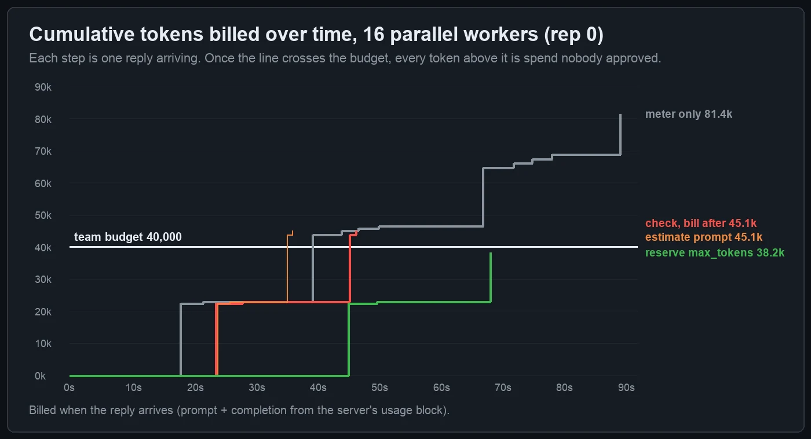
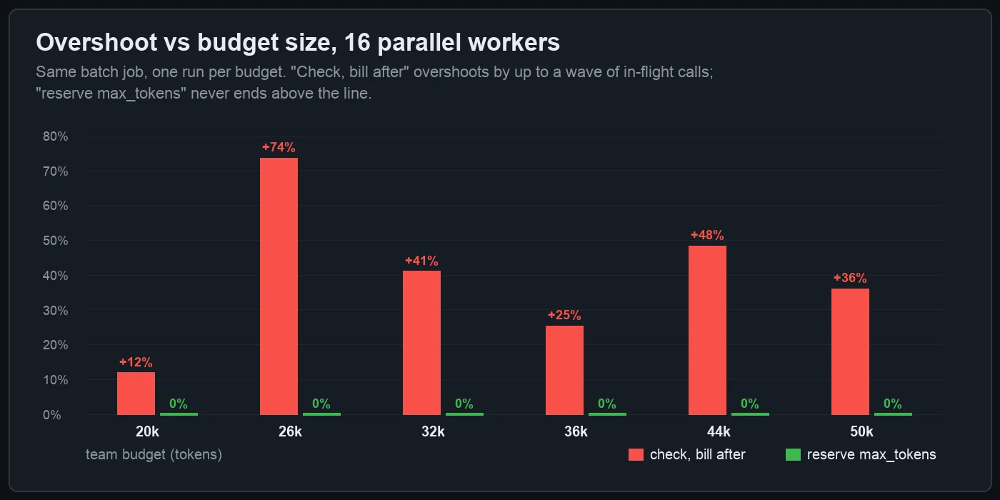
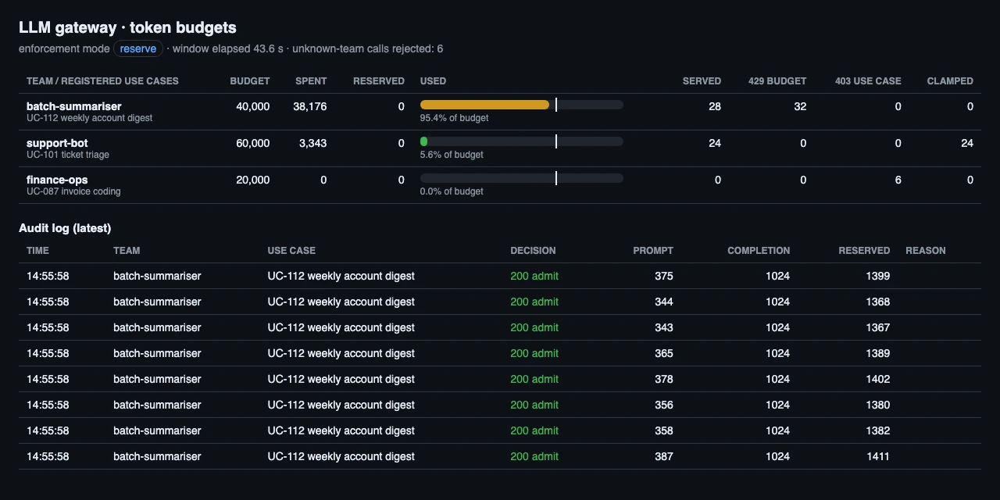

Every enterprise AI rollout I have seen gets to the same slide sooner or later: "each team gets a monthly token budget". Finance likes it, the platform team builds it into the LLM gateway, and the governance board ticks the cost-control box. Then the first invoice arrives and one team is 40% over a budget that the gateway was supposed to enforce.

The budget was enforced. It was enforced the way most gateways do it: check the balance when a request comes in, add the tokens when the reply comes back. With one request at a time that is exact. With a batch job running 16 workers it is not, because 16 calls pass the check before the first one is billed.

I wanted numbers rather than a hunch, so I built a small gateway with four admission rules, put a real model behind it and ran the same workload through each rule. Everything below comes from those runs. The harness is in the repo, so you can run it yourself.

## The setup

- **Model and server:** SmolLM2-135M-Instruct converted to GGUF, served by `llama-server` (llama.cpp build 11669, Metal) on an M2 Pro with 20 parallel slots. The model is small on purpose, so a run takes about a minute. Token accounting does not care how good the model is. It only cares that real replies come back with real `usage` blocks and real latency.
- **Gateway:** `scripts/enterprise-ai-token-budgets/gateway.py`, about 300 lines of standard-library Python. It sits in front of `/v1/chat/completions`, reads `x-team` and `x-use-case` headers, keeps a per-team ledger, writes one audit line per decision and serves a `/budgets` status page. The two status screenshots below come from that page.
- **Teams** (from the gateway's register):
  - `batch-summariser`: 40,000-token budget, use case `UC-112 weekly account digest`, `max_tokens` cap 1,024.
  - `support-bot`: 60,000-token budget, `UC-101 ticket triage`, cap 512.
  - `finance-ops`: 20,000-token budget, `UC-087 invoice coding`, cap 512.
- **Workload per run** (seeded, the same for every rule):
  - 60 weekly-digest calls from `batch-summariser`. Each has about 370 prompt tokens and asks for up to 1,024 completion tokens. 4 or 16 workers pull them from one queue, and a 429 drops the item (no retry).
  - 24 triage calls from `support-bot` that ask for `max_tokens: 4096`.
  - 6 calls from `finance-ops` under a use case it never registered, and 6 calls from a team the gateway has never heard of.
- **Runs:** 4 rules × 2 concurrency levels × 3 repetitions = 24 runs, plus a sweep over six budget sizes. Results are medians over the repetitions.

The four admission rules:

| Mode | Admit when | Charge |
|---|---|---|
| `none` (meter only) | always | prompt + completion when the reply arrives |
| `post` (check, bill after) | spent < budget | prompt + completion when the reply arrives |
| `estimate` (estimate prompt) | spent + prompt ≤ budget | prompt at admission, completion when the reply arrives |
| `reserve` (reserve `max_tokens`) | spent + reserved + prompt + max_tokens ≤ budget | hold the reservation while the call runs, then settle to real usage |

`estimate` is what you get from gateway policies that count prompt tokens up front. Azure API Management's token-limit policies, for example, have an `estimate-prompt-tokens` switch. My gateway counts the prompt exactly: it applies the server's own chat template and calls its `/tokenize` endpoint. The estimate matched the server's `prompt_tokens` in all 656 admitted calls that used it. So whatever `estimate` gets wrong below, inaccurate counting is not the reason.

## Result: only the reservation keeps spend under the budget

{: width="1400" height="760" }

*Median of three runs per bar, with the worst run marked by a tick. The white line is the budget. In every run, `reserve` stayed under the line and the other three ended above it.*

| Mode | Workers | Billed (median) | vs budget | Calls served | Calls refused (429) |
|---|---:|---:|---:|---:|---:|
| meter only | 4 / 16 | 82,424 / 82,591 | +106% / +107% | 60 / 60 | 0 / 0 |
| check, bill after | 4 / 16 | 45,014 / 45,148 | +12.5% / +12.9% | 33 / 33 | 27 / 27 |
| estimate prompt | 4 / 16 | 43,825 / 45,148 | +9.6% / +12.9% | 32 / 33 | 28 / 27 |
| reserve max_tokens | 4 / 16 | 39,601 / 38,176 | 99.0% / 95.4% used | 29 / 28 | 31 / 32 |

Four things stand out:

1. **Meter-only is a report, not a control.** The job ran to completion and spent twice its budget. Dashboards and chargeback are still worth having (see the [cost observability dashboard](/posts/enterprise-ai-azure-openai-cost-observability-dashboard/)), but they only tell you about the overspend after it has happened.
2. **Check-then-bill overshot in every run.** At 16 workers, 4 or 5 calls were still running when the 30th reply pushed spend past 40,000. They had all passed the check, so each of them was billed in full.
3. **Estimating the prompt barely helps.** Completion tokens were 72% of all billed tokens in this workload, and 94-97% of the digest calls used their full 1,024-token allowance. An exact prompt count is still a guess about the smaller part of the bill. At 16 workers, `estimate` billed exactly the same 33 calls as `post`.
4. **Reserving the worst case holds the line.** It also costs something: at 16 workers the job used 95% of its budget, not 100%, and served 28 calls instead of 33. More on that trade-off below.

## Why check-then-bill overshoots: calls in flight

{: width="1400" height="760" }

*Each step is one reply arriving. In `post` and `estimate` mode the line passes the budget, and the replies already in flight keep adding to it. The `reserve` line flattens below the budget because the gateway stopped admitting calls before it could cross.*

The overshoot is not a fixed percentage. Its upper bound is the number of calls in flight × (prompt + `max_tokens`) per call. At 16 workers and about 1,394 tokens per call, that is up to about 22,000 tokens. How much of that bound you actually hit depends on where the budget falls relative to the waves of calls. So I swept the budget:

{: width="1400" height="700" }

*One run per budget at 16 workers. With check-then-bill, a 26,000-token budget ended at 45,148 tokens, the same as a 40,000-token one: after the first wave of 16 calls was billed (about 22,000 tokens), the balance was still under 26,000, so a second full wave was admitted.*

Overshoot ranged from 12% to 74% with no pattern a finance team could plan around. Across the same sweep, reserve mode used 93-98% of each budget and never went over.

## What the governance surface looks like

Here is the gateway's own status page at the end of a check-then-bill run with 16 workers. It is a real headless-browser screenshot of `GET /budgets`, taken while the gateway was still up:

{: width="1280" height="640" }

*Check-then-bill: the red bar runs past the white budget marker. The audit log shows 429s, so the gateway did refuse calls, but only after the overspend was already in flight.*

And the same workload in reserve mode:

{: width="1280" height="640" }

*Reserve mode: the batch team ends under its budget, and the other teams' budgets are untouched because each team has its own ledger.*

The other controls in the gateway worked the same in every mode, so I checked them once and moved on:

- **Use-case register:** all 6 calls under an unregistered use case and all 6 from an unknown team got a 403 in all 24 runs, and none of them reached the model. This is the enforcement half of a [use-case intake register](/posts/enterprise-ai-use-case-intake-risk-tiers-governance/): if a use case is not in the register, it gets no tokens.
- **`max_tokens` ceiling:** `support-bot` asked for 4,096 on every call. The gateway clamped all 24 to 512 per run. The median triage reply was 56 tokens and 16 of 576 replies reached 512, so the cap cost almost nothing while cutting each call's worst case by a factor of 8. It also makes reservations smaller (see below).
- **Isolation:** `support-bot` served 24 of 24 calls in every mode, including the runs where the batch team was being refused.

## The cost of reserving: admission time and unused headroom

Reservation is not free, so here is what it cost in these runs:

- **Admission latency:** counting the prompt (template + tokenize, two local round trips) took a median of 2.4-3.6 ms per admitted call, with a p95 of 6-11 ms. The median model call took 11-45 s, depending on the run. In a production gateway you would count with a local tokenizer and skip the round trips.
- **Refusals are fast:** a budget 429 came back in a median of 2-14 ms. That matters because a job that is refused quickly can back off politely. Treating 429s as a signal to retry immediately is how [a retry storm burned 4M tokens](/posts/enterprise-ai-retry-storm-burned-4m-tokens/).
- **Unused headroom:** reserve mode refuses a call when the remaining budget is smaller than one worst case (about 1,394 tokens). It also refuses calls while other calls hold reservations that will later settle lower. That is why the 16-worker runs ended at 95% and not 99%. A batch job that honours `Retry-After` gets that headroom back when the reservations settle. My load generator drops refused items, so this is the pessimistic case.

If 95% feels too conservative, lower `max_tokens` before you loosen the rule. The reservation is only as large as the worst case you allow. A 512-token cap on the digest job would halve each reservation, and the unused remainder with it.

## A minimal reservation ledger

This is the core of the reserve rule from the gateway, without the HTTP plumbing:

```python
def admit(team, prompt_tokens, max_tokens):
    with lock:
        need = prompt_tokens + max_tokens          # worst case for this call
        if team.spent + team.reserved + need > team.budget:
            return 429                              # refuse before any token is generated
        team.reserved += need
        return need                                 # the caller holds this until settle()

def settle(team, held, usage):
    with lock:
        team.reserved -= held                       # give back the worst case
        team.spent += usage.prompt_tokens + usage.completion_tokens  # bill what actually happened

def release(team, held):                            # upstream error or timeout
    with lock:
        team.reserved -= held
```

Two details matter in production:

- **One ledger, one lock.** If the gateway runs several replicas, the reservation has to be atomic in shared state, for example a Redis `INCRBY` guarded by a Lua script or a database row with a conditional update. If each replica keeps its own ledger, every replica will happily admit up to the full budget.
- **Release on every failure path.** A reservation that is never released is a budget leak. Release on upstream errors, client disconnects and timeouts, and expire reservations older than the longest timeout you allow.

## What to take into your rollout

- [ ] Every team or use case gets its budget at the gateway, keyed to an entry in the use-case register. Calls without a registered use case get a 403.
- [ ] The budget check **reserves** prompt + `max_tokens` and settles to real usage. If your gateway can only check then bill, set the budget lower by at least (expected concurrency × worst-case tokens per call).
- [ ] Every team has a `max_tokens` ceiling, and requests above it are clamped. The ceiling is your overshoot bound and your reservation size.
- [ ] Batch jobs honour `Retry-After` on a budget 429 and never retry it in a tight loop.
- [ ] The audit log records each admit/refuse decision with the reservation and the settled usage, so chargeback reconciles to the ledger and not to an estimate.
- [ ] Test the budget with the concurrency you will actually run. A budget that holds with one worker tells you nothing about sixteen.

## Run it yourself

The harness only needs the standard library, plus Pillow for the charts. Any OpenAI-compatible server works as the upstream. You need `/apply-template` and `/tokenize` for exact prompt counts (llama-server has both). Swap in your own tokenizer for anything else.

```bash
python3 scripts/finetune-eval/hf_to_gguf.py <SmolLM2-135M-Instruct snapshot> .tmp/smollm2-135m-f32.gguf
llama-server -m .tmp/smollm2-135m-f32.gguf --port 18431 -np 20 -c 81920 -ngl 99 &
cd scripts/enterprise-ai-token-budgets
python3 run_experiment.py --modes none,post,estimate,reserve --conc 4,16 --reps 3 \
    --out ../../.tmp/budgets-raw.jsonl --audit-dir ../../.tmp/audit | tee ../../.tmp/budgets-term.txt   # ~50 min
python3 budget_sweep.py --out ../../.tmp/budget-sweep.jsonl                                           # ~9 min
python3 summarise.py --raw ../../.tmp/budgets-raw.jsonl --audit-dir ../../.tmp/audit --sweep ../../.tmp/budget-sweep.jsonl
python3 capture_status.py --mode post --out ../../.tmp/status-post.html   # then screenshot it headless
```

The summarised numbers are in `scripts/data/enterprise-ai-token-budgets.json`. Here is the raw output of the 24-run experiment:

{: width="1400" height="880" }

*The raw experiment log, colour-coded by rule. Repetitions differ by up to about 1,700 tokens because the model samples at temperature 0.8. The ranking of the four rules was the same in all three repetitions.*

To size budgets and `max_tokens` caps before you set them, the [Lamplit Labs token counter](https://tools.lamplitlabs.com/token-counter) shows what your real prompts cost in tokens, and the [AI pricing calculator walkthrough](/posts/ai-pricing-calculator-estimating-llm-api-costs-before-you-ship/) turns that into a monthly figure.

*We run the gateways behind Lamplit Labs' products with reservation-based budgets for this reason. Changing one control at a time and measuring it against a baseline before trusting it is also at the core of **Pulse**, Lamplit Labs' self-improving automation product, coming soon.*

## Related posts

- [Per-team token quotas and chargeback with Azure API Management](/posts/enterprise-ai-apim-token-quotas-chargeback-azure-openai/)
- [Audit logging and policy controls for an LLM gateway](/posts/enterprise-ai-llm-gateway-audit-logging-policy-controls/)
- [A use-case intake form and three risk tiers](/posts/enterprise-ai-use-case-intake-risk-tiers-governance/)
- [Continuous batching in llama.cpp, measured](/posts/continuous-batching-llm-serving-llama-cpp-measured/)
- [Pulse: Lamplit Labs' self-improving automation product, coming soon](/posts/pulse-internal-rsi-tool/)
