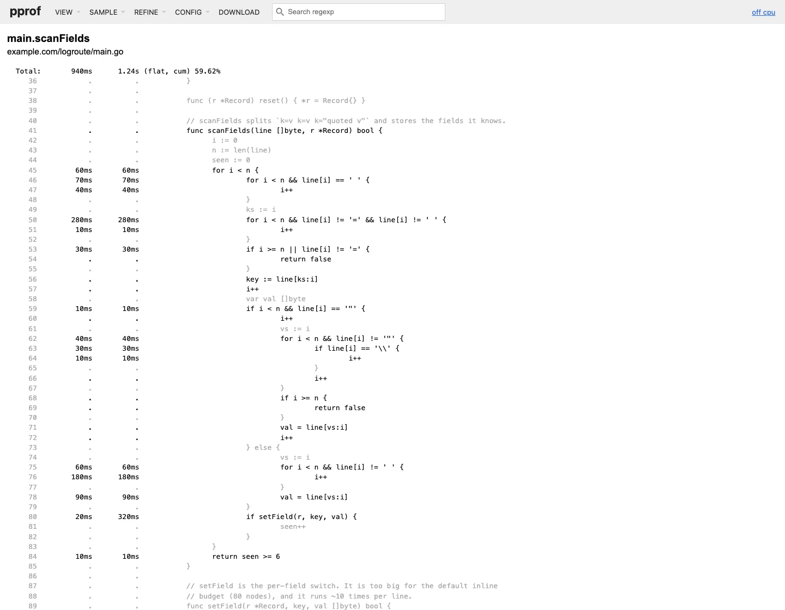

Go has had profile-guided optimization (PGO) since 1.21. You give `go build` a CPU profile, and the compiler uses it to inline and devirtualize the calls that are hot in production. The usual promise is "a few percent faster". We wanted three answers that promise does not give:

1. **How much** does it save on a real-shaped hot loop, counted in instructions so host noise is not part of the number?
2. **Which** of the two optimizations does the work, inlining or devirtualization?
3. **How good** must the profile be? How short can it be, how badly can it match the traffic, and does profiling the PGO build again help?

We measured all three on one program and eight builds of it. The program, the measurement script and every number in this post are in this blog's repository under `scripts/go-pgo/`.

## The workload: a log router

`logroute` is a small, standard-library-only log router. For each `key=value` access-log line it:

- parses the fields into a `Record` (`scanFields` plus a per-field `setField` switch),
- walks a rule table of `Matcher` interfaces (route prefix, status range, level, service set, slower-than),
- and writes the record to a `Sink` interface: a per-route latency histogram or a counter.

```go
func (rt *Router) Route(line []byte, rec *Record) {
	rec.reset()
	if !scanFields(line, rec) {
		rt.bad++
		return
	}
	matched := false
	for i := range rt.rules {
		ru := &rt.rules[i]
		if ru.M.Match(rec) {              // interface call, line 276
			rt.sinks[ru.Sink].Write(rec)  // interface call, line 277
			matched = true
			if !ru.Continue {
				break
			}
		}
	}
	if !matched {
		rt.dropped++
	}
}
```

That shape (a tokenizer too big for the default inline budget, called once per input, plus interface dispatch inside a loop) is the shape PGO is built for. It also matches our [Go pprof guide](/posts/go-pprof-profiling-guide-cpu-goroutine-mutex/) gateway and many real services.

It runs with two rule sets. **api** is an API gateway, where rules are mostly route-prefix matchers. **batch** is a batch-job pipeline, where rules are mostly status and level matchers. Each config reads 1,000,000 seeded lines (143 MB) such as:

```text
ts=1762819200062 level=info svc=edge method=GET route=/api/v1/search status=304 dur_ms=89 bytes=17124 user=u36617 msg="retry 1 of 3"
```

Every build prints the same checksum for each config (`11463464160021572079` for api, `124650555801876366` for batch), so no build "wins" by doing less work.

**Test machine:** Apple M2 Pro (12 cores), macOS 27.0.1, go1.27.2 darwin/arm64, `go build -trimpath`.

## How we measured, and why not wall time

The Mac was shared with other jobs while we measured, with a load average of 5 to 12. In five runs, the PGO-off build's best pass on the api config ranged from 246 to 384 ns per line. A 50% swing hides a 9% effect. So the main numbers are hardware counters from `/usr/bin/time -l`:

- **instructions retired** is deterministic for a given binary and input. It repeated within 0.27-0.41% across runs in every cell.
- **cycles elapsed** is the CPU work actually done. It moves with cache and frequency effects, but much less than wall time.

Each run is 5 passes over the 1,000,000 lines. We subtract the median counters of a `reps=0` run (load the file, route nothing), then divide by 5,000,000 to get **instructions and cycles per routed line**. Every (build, config) cell has 5 runs, interleaved so host load drifts over all builds alike. The tables show medians.

```bash
bash scripts/go-pgo/measure.sh /tmp/go-pgo        # ~4 min: profiles, 8 builds, 80 timed runs
python3 scripts/go-pgo/summarise.py /tmp/go-pgo   # -> scripts/data/go-pgo-m2pro.json
BROWSER_PATH=<chrome-headless-shell> bash scripts/go-pgo/shots.sh /tmp/go-pgo   # pprof web UI screenshots
python3 scripts/go-pgo/gen_images.py /tmp/go-pgo  # every image on this page
```

## Step 1: collect a profile, rebuild

The profile is an ordinary `runtime/pprof` CPU profile of the PGO-off binary, taken over 10 passes of the api log: 2.44 s, 2,080 ms of samples, 2,830 bytes on disk. In a service you would download `/debug/pprof/profile?seconds=30` from production instead.

```bash
go build -pgo=off -o bin/off .
./bin/off run api api.log 10 profiles/api.pprof
go build -pgo=profiles/api.pprof -o bin/pgo .    # or commit it as default.pgo next to main.go
```

Here is the input profile in the pprof web UI (`go tool pprof -http`). Most of the time is in `scanFields`, then the matcher and the histogram sink:


Note what the flame graph does **not** show. The two graphs look almost the same, because pprof draws inlined functions as their own frames (it marks them `(inline)` in `-top` output). A profile shows *where* the time goes, not what the compiler did about it. To see that, ask the compiler.

## Step 2: what the compiler did differently

`-gcflags=-m` prints every inlining and devirtualization decision. We diffed it without and with the profile. These are all the lines only the PGO build prints. No decision went the other way:

![Terminal panel titled "what PGO changed: -gcflags=-m diff". After two go build -gcflags=-m runs and a comm -13 of their outputs, the PGO-only lines are: can inline scanFields (main.go:41), inlining call to parseUint and setField at main.go:80, can inline setField, can inline (*histSink).Write, can inline (*Router).Route, inlining call to scanFields at main.go:269, PGO devirtualizing interface call ru.M.Match to (*routePrefix).Match at main.go:276, inlining of (*routePrefix).Match, bytes.Equal and bytes.HasPrefix there, PGO devirtualizing rt.sinks[ru.Sink].Write to (*histSink).Write at main.go:277 with routeKey and bucketFor inlined, and Router.Route and Record.reset inlined into main at line 433. Footer: 72 inlining lines without PGO, 87 with it; 0 decisions lost.](/assets/img/posts/performance/go-pgo-gcflags-m-diff.webp)

Two kinds of change:

- **Hot-call-site inlining.** The default inline budget is 80 nodes. `scanFields` (cost 477) and `setField` (cost 301) are far over it, so without PGO each line pays a real call for `scanFields` and about ten for `setField`. PGO raises the budget to 2,000 for call sites the profile marks as hot.
- **Devirtualization.** At the `ru.M.Match` and `.Write` call sites, the profile says the concrete type is almost always `*routePrefix` and `*histSink`. The compiler adds a type check with a direct, inlinable call on the fast path and keeps the interface call as the fallback.

The compiler explains its choices with `-gcflags=-d=pgodebug=1`. This is also where a short profile shows its weakness:

![Terminal panel titled "the compiler's own account: -d=pgodebug=1". With the 2.4 s api profile (2,080 ms of samples): hot-callsite-thres-from-CDF=0.37, and hot-budget checks allow inlining of Router.Route (cost 921) into main, histSink.Write (cost 173) and scanFields (cost 477) into Router.Route, and setField (cost 301) into scanFields; 10 functions get the increased budget of 2000. With the 0.4 s profile (230 ms of samples): hot-callsite-thres-from-CDF=4.35, only scanFields (cost 233) is allowed into Router.Route, and only 2 functions get the bigger budget.](/assets/img/posts/performance/go-pgo-pgodebug.webp)

## Step 3: the numbers

![Chart of change in instructions and cycles per routed line against PGO off, for eight builds and two configs. PGO with the api profile: api -8.8% instructions and -5.6% cycles, batch -10.0% and -4.5%. Devirtualization off: -8.7%/-3.9% and -10.0%/-5.3%. Inlining off: +0.2%/-0.7% and +1.8%/+2.1%. 0.4 s api profile: -0.2%/+0.3% and -0.2%/+1.0%. Batch profile: -8.7%/-6.9% and -10.0%/-7.0%. Merged api plus batch: -8.7%/-6.2% and -10.0%/-5.5%. Profile of the PGO build: -8.7%/-6.8% and -10.0%/-7.4%. Baseline: api 3,322 instructions and 850 cycles per line, batch 2,876 and 716.](/assets/img/posts/performance/go-pgo-results.webp)

| Build | api instr./line | api cycles/line | batch instr./line | batch cycles/line |
|---|---:|---:|---:|---:|
| PGO off | 3,322 | 850 | 2,876 | 716 |
| PGO, api profile (2.4 s) | 3,032 (**-8.8%**) | 802 (-5.6%) | 2,590 (**-10.0%**) | 684 (-4.5%) |
| PGO, devirtualization off | 3,033 (-8.7%) | 817 (-3.9%) | 2,588 (-10.0%) | 678 (-5.3%) |
| PGO, inlining off | 3,330 (+0.2%) | 844 (-0.7%) | 2,929 (+1.8%) | 731 (+2.1%) |
| PGO, 0.4 s api profile | 3,316 (-0.2%) | 853 (+0.3%) | 2,869 (-0.2%) | 723 (+1.0%) |
| PGO, batch profile | 3,034 (-8.7%) | 792 (-6.9%) | 2,588 (-10.0%) | 666 (-7.0%) |
| PGO, api + batch merged | 3,033 (-8.7%) | 798 (-6.2%) | 2,589 (-10.0%) | 677 (-5.5%) |
| PGO, profile of the PGO build | 3,034 (-8.7%) | 792 (-6.8%) | 2,588 (-10.0%) | 663 (-7.4%) |

Raw data: `scripts/data/go-pgo-m2pro.json` in this blog's repository.

What it says:

**1. PGO removed 8.8-10% of the instructions per line, and 4.5-7.4% of the cycles.** Cycles fall less than instructions because the removed instructions were cheap ones: call and return, and spilling and reloading arguments around each call. The PGO-off binary already ran at 3.9-4.0 instructions per cycle, so dropping the easy instructions lowers IPC (3.79 with PGO). It does not cut cycles one for one. Expect a cycle gain of roughly half the instruction gain on code that is already this efficient.

**2. All of the gain is inlining. Devirtualization contributed nothing here.** With `-d=pgodevirtualize=0` the build keeps 8.7%/10.0% of the 8.8%/10.0%. With `-d=pgoinline=0` the gain is gone, and the batch config gets 1.8% *worse*, because the devirtualized fast path adds a type check and the target is no longer inlined behind it. Our matchers are tiny, so an indirect call to them was never the expensive part. The `scanFields` → `setField` → `parseUint` chain, about ten calls per line, was. If your hot interface calls go to tiny methods, do not expect much from devirtualization.

**3. The profile must be long enough to have a shape.** The 0.4 s profile (230 ms of samples, 712 bytes) found `scanFields` and nothing else. Its hot-call-site threshold was 4.35% of samples, against 0.37% for the 2.4 s profile, so `setField` and `histSink.Write` stayed out of line and the gain was 0.2%. Go's PGO guide uses a 30 s production profile in its example. That is not a ritual: too few samples means too few call sites cross the hot threshold.

**4. A "wrong" profile is fine when the hot code is the same.** The batch profile, built from a different rule mix, gave the api config the same 8.7% instruction cut. A merged profile (`go tool pprof -proto a.pprof b.pprof > merged.pprof`) did as well on both. The parser is the hot path whatever the rules are, so any realistic profile finds it. This is good news for services with several traffic shapes: merge the profiles from several instances and stop worrying about which one is "representative".

**5. Re-profiling the PGO build changed nothing.** A profile of the PGO binary, fed back into a new build, gave -8.7%/-10.0%. Go's PGO is designed to be stable when you iterate: the profile still credits samples to the inlined functions, so the same call sites stay hot. You can commit `default.pgo` from production every release without the gain drifting.

**6. Build cost and binary size did not move.** Three full rebuilds each (`go build -a`, standard library included) took a median of 3.13 s without PGO and 2.93 s with it, which is within host noise on this machine. The binary changed by -64 bytes (2,817,170 → 2,817,106). On a large service a PGO build can take longer, because the profile also applies to every dependency. Measure your own build before you put PGO in a tight CI loop.

## Where the time was: the source view

The pprof source view of the input profile shows why inlining `setField` matters. The tokenizer loop in `scanFields` holds 940 ms of the 2,080 ms of samples (flat) and 1.24 s cumulative. The difference is the per-field call out to `setField` and `parseUint`, which PGO pulls into the loop:



## A checklist for turning PGO on

1. **Profile production, not a benchmark.** Collect a CPU profile of at least 30 s, under real load, from the binary you ship (`/debug/pprof/profile?seconds=30`). Merge profiles from several instances with `go tool pprof -proto`.
2. **Commit it as `default.pgo`** in the main package's directory. `go build` uses it by default (`-pgo=auto`), and `go version -m` shows `-pgo=...` in the binary's build info, so you can check what shipped.
3. **Read the diff, not just the benchmark.** Run `-gcflags=-m` with and without the profile and compare. `-d=pgodebug=1` tells you which call sites crossed the hot threshold. If the list is short, the profile is too short.
4. **Measure with counters or many interleaved runs.** A 5-10% gain is smaller than the run-to-run noise of wall time on a busy machine. Here, instructions retired repeated within 0.4%. Wall time moved by 50%.
5. **Refresh it each release, and do not chase it.** Re-profiling the PGO build gave the same result, so a stale-by-one-release profile costs little.
6. **PGO does not replace fixing the code.** In our [pprof guide](/posts/go-pprof-profiling-guide-cpu-goroutine-mutex/), three code fixes cut p99 from 24 ms to 5.1 ms. PGO gave about 9% of instructions here, for free. Do both, in that order.

## Takeaways

- `go build -pgo` cut **8.8-10.0% of instructions** and **4.5-7.4% of cycles** per routed line, with identical output, no code change, the same binary size and no measurable build-time cost.
- **Inlining did all of it.** With devirtualization disabled the result was the same. With inlining disabled the gain disappeared, and one config got 1.8% worse.
- A **0.4 s profile did nothing**, because too few call sites crossed the hot threshold. Profiles from a different traffic mix, merged profiles, and a profile of the PGO build all gave the same gain.
- Check PGO with the compiler's own output (`-gcflags=-m`, `-d=pgodebug=1`) and with instruction counters. Do not trust one wall-clock benchmark.

*We use this measure → change one thing → re-measure loop on the Go services behind Lamplit Labs' products. Measuring a change against a baseline before accepting it is also at the core of **Pulse**, Lamplit Labs' self-improving automation product, coming soon.*

## Related reading

- [Go pprof Profiling Guide: CPU, Goroutine and Mutex Profiles on One Service](/posts/go-pprof-profiling-guide-cpu-goroutine-mutex/): how to collect and read the CPU profile PGO feeds on.
- [Go pprof alloc_space: 2.87 GB of garbage from one `+=` in a loop](/posts/go-pprof-alloc-space-escape-analysis/): the other half of `-gcflags=-m`, escape analysis.
- [GOGC=off with runtime.SetMemoryLimit](/posts/go-gogc-off-memory-limit-p99/): a runtime knob to try after the compiler ones.
- [Rust Release Profiles: LTO, codegen-units and target-cpu](/posts/rust-lto-codegen-units-release-profile/): the same "build settings, measured" question for Rust.
- [Rust Profiling Practical Guide: sample, Flame Graphs and a Counting Allocator, Measured](/posts/rust-profiling-practical-guide-sample-flamegraph/): instruction counters on macOS with `/usr/bin/time -l`, the method used here.
- [Pulse: Lamplit Labs' self-improving automation product, coming soon](/posts/pulse-internal-rsi-tool/): the product mentioned above.
